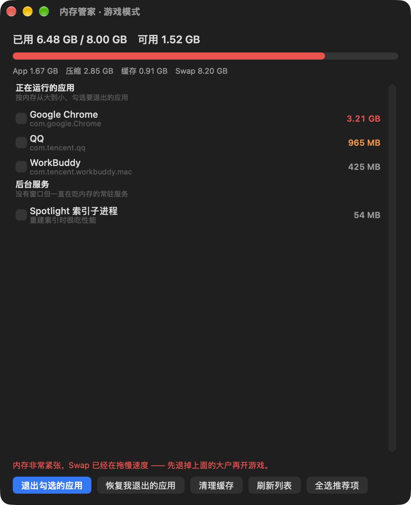
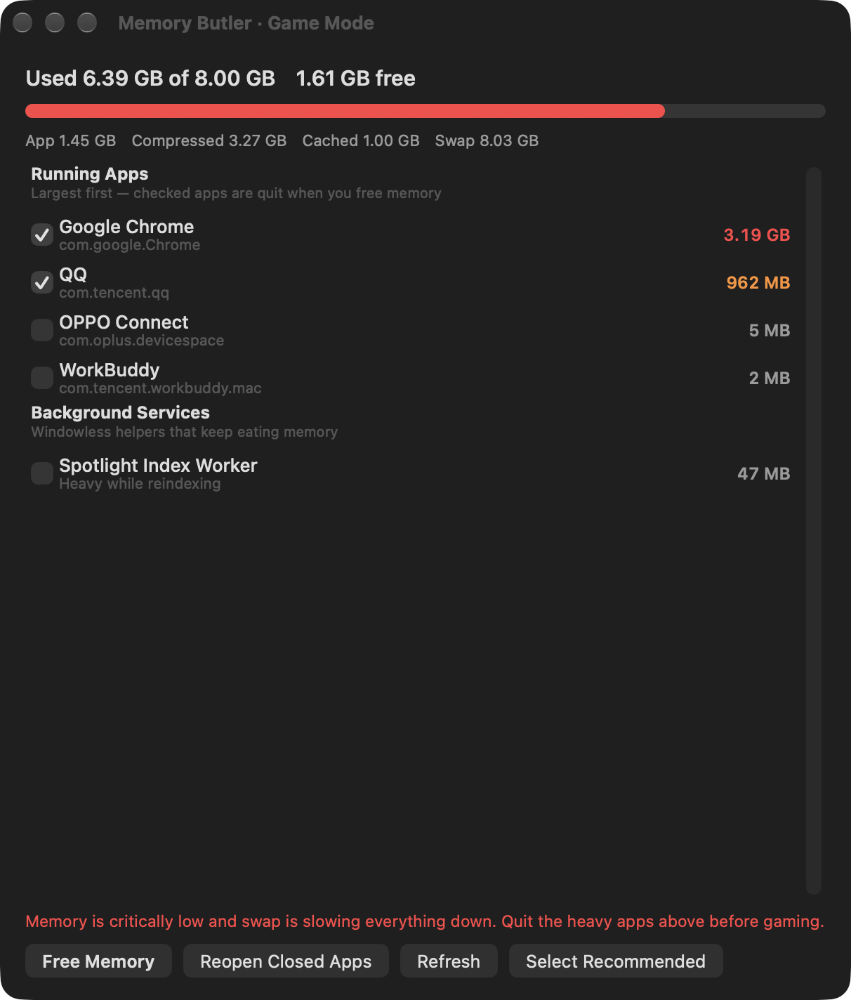

<div align="center">

# Memory Butler · Game Mode / 内存管家 · 游戏模式

**Free up real memory for gaming on small-RAM Macs.**
**为小内存 Mac 游戏腾出真实可用内存的原生小工具。**

[English](#english) ｜ [简体中文](#简体中文)

 

</div>

---

<a name="简体中文"></a>

## 简体中文

一个住在菜单栏里的原生 macOS 工具（Swift 编写，**单文件、零依赖、纯系统 API**），
专为 **8GB 及以下内存的 Mac** 玩游戏设计：随时看清谁在吃内存，开游戏前一键把不需要的程序退掉，玩完一键恢复。

> 为什么它和市面上的"内存清理大师"不一样？
> macOS 会主动压缩、交换内存，"一键清理"大多是安慰剂。
> 真正有效的只有一件事：**把真正在吃内存的程序退掉**。这个工具就是干这个的。

### ✨ 功能

- 🟢🟠🔴 菜单栏实时显示可用内存，红/橙/绿三档提示内存压力；Dock 里也有图标
- 📋 面板按内存**从大到小**列出运行中的应用和后台服务（Chrome 的 Helper 子进程自动并入主程序，不重复计数）
- ☑️ **默认全不勾选**，你自己挑要退的应用；「全选推荐项」一键勾上浏览器、微信/QQ、Docker、网盘同步等重内存程序
- 🚀 **退出勾选的应用**：温和退出（等价点红叉，走保存流程）；顽固不退的会先问你，确认后才强退，避免误丢数据
- ↩️ **恢复我退出的应用**：玩完游戏把退掉的应用全部重新打开（记录会持久化，重启也不丢）
- 🧹 **清理缓存**：清掉系统文件缓存（和 Memory Cleaner 同原理），但老实说——缓存本来不挡路，长期收益有限，所以只做辅助按钮
- 🌐 **内置中英双语**：菜单栏「语言 / Language」随时切换，无需重启
- 🔐 退出系统级后台服务时才需要管理员密码，普通应用完全不需要

### 📦 安装

1. 到 [Releases](../../releases) 下载最新的 `内存管家-x.x.dmg`
2. 打开 DMG，把 **内存管家** 拖进 **Applications**
3. 双击运行，看屏幕右上角菜单栏

> 首次运行提示"无法验证开发者"：在应用程序文件夹里 **右键 → 打开 → 打开** 即可（本地自编译软件没有苹果开发者证书，属正常现象）。

### 🎮 使用流程

```
打开面板 → 勾选要退出的应用 → 「退出勾选的应用」 → 开游戏
                                    ↓
          玩完 → 「恢复我退出的应用」 → 一切如初
```

> 「清理缓存」按钮可点可不点 —— 它清的只是文件缓存，游戏需要内存时系统本来就会让位，所以它对游戏帮助不大，别把它当主菜。

### 🔨 从源码构建

```bash
git clone https://github.com/<你的用户名>/memory-butler.git
cd memory-butler
bash build.sh        # 需要 Xcode Command Line Tools（免费）：xcode-select --install
```

产物：`内存管家.app`（带图标、ad-hoc 签名）。命令行自检：`./内存管家.app/Contents/MacOS/GameMode --selftest`

### 💡 诚实的说明

- macOS 的"内存已用 90%"不一定是坏事 —— 系统会把不常用内存压缩起来。真正拖慢游戏的是 **Swap 交换**和**内存压力**，面板里都有显示。
- 「清理缓存」（purge）效果是瞬时的，系统很快会把文件缓存填回来，对游戏帮助有限。
- 退出应用用的是温和退出流程（等价点红叉），有未保存的文档会先弹保存提示；顽固不退的应用会先问你，确认后才强退。

### 📄 License

MIT

---

<a name="english"></a>

## English

A native macOS menu-bar utility (written in Swift — **one file, zero dependencies, system APIs only**)
built for **Macs with 8 GB of RAM or less**: see who is eating memory, quit the unneeded apps before you
launch a game, and bring everything back when you are done.

> Why is this different from "memory cleaner" apps?
> macOS compresses and swaps memory on its own, so one-click "cleaners" are mostly placebo.
> The only thing that actually helps is **quitting the apps that really hold memory**. That's exactly what this does.

### ✨ Features

- 🟢🟠🔴 Live free-memory readout in the menu bar with a 3-level pressure indicator; also shows in the Dock
- 📋 Panel lists running apps and background services **largest first** (Chrome helpers are merged into the parent app, no double counting)
- ☑️ **Nothing pre-checked** — you pick what to quit; "Select Recommended" checks browsers, messengers, Docker, sync clients in one click
- 🚀 **Quit Checked Apps**: gentle quit first (same as clicking the red button, runs the save flow); stubborn apps ask before force-quitting so you never lose work
- ↩️ **Reopen Closed Apps**: restores everything after gaming (the list survives restarts)
- 🧹 **Clear Cache**: flushes the file cache (same mechanism as Memory Cleaner) — but honestly, cache doesn't block games, so it's a secondary button, not the main event
- 🌐 **Built-in English / 简体中文** switcher in the menu — no restart needed
- 🔐 Admin password is only ever needed for system-level background services

### 📦 Install

1. Grab the latest `内存管家-x.x.dmg` from [Releases](../../releases)
2. Open the DMG and drag **内存管家** into **Applications**
3. Launch it and look at the top-right of your menu bar

> If macOS says the app "can't be verified": right-click the app in /Applications → **Open** → Open again.
> This is normal for locally-built, unsigned apps.

### 🎮 Workflow

```
Open panel → check apps to quit → "Quit Checked Apps" → play
                                        ↓
        when done → "Reopen Closed Apps" → back to normal
```

> "Clear Cache" is optional — it only flushes the file cache, which the system gives up anyway when a game needs memory, so it won't help much. It's a side button, not the main one.

### 🔨 Build from source

```bash
git clone https://github.com/<your-username>/memory-butler.git
cd memory-butler
bash build.sh        # requires free Xcode Command Line Tools: xcode-select --install
```

Output: `内存管家.app` (with icon, ad-hoc signed). Headless self-test: `./内存管家.app/Contents/MacOS/GameMode --selftest`

### 💡 Honest notes

- "90% memory used" on macOS is not necessarily bad — the system compresses inactive memory.
  What actually slows games down is **swap** and **memory pressure**; the panel shows both.
- "Clear Cache" (purge) is momentary — the system refills the file cache quickly, so it won't help games much.
- Apps are quit gently (like clicking the red button); unsaved documents prompt first, and stubborn apps ask before force-quitting.

### 📄 License

MIT
